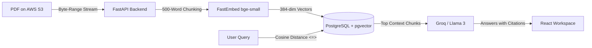

# DocMind AI

A document intelligence workspace that combines an asynchronous RAG pipeline, local CPU embedding vectorization, and pre-computed quiz synthesis for PDF study and review.

---

## 🏗️ Architecture Flow



---

## 💡 Key Engineering Decisions

- **Local CPU Embeddings (`FastEmbed`):** Uses `bge-small-en-v1.5` to generate 384-dimensional dense vectors on CPU. Eliminates external embedding API costs and network latency.
- **Unified Vector Storage (`pgvector`):** Stores document chunks, relational metadata, and embeddings inside PostgreSQL. Eliminates dual-write sync issues across external vector databases.
- **Native SQL Cosine Search:** Executes vector similarity queries using the `<=>` cosine distance operator with parameterized queries for sub-40ms context retrieval.
- **Pre-computed Quiz Explanations:** Generates questions, options, and explanations in a single batch LLM request. Enables 0ms client-side answer verification without recurring LLM API calls.
- **Memory-Safe PDF Streaming:** Ingests and streams documents using HTTP 206 byte-range requests directly from AWS S3, avoiding RAM bottlenecks when loading large files.

---

## 🛠️ Tech Stack

| Component | Technology | Purpose |
| :--- | :--- | :--- |
| **Backend** | FastAPI (Python 3.11+) | Async REST API & OpenAPI schema |
| **Database** | PostgreSQL + `pgvector` | Relational data & vector similarity search |
| **Storage** | AWS S3 | Cloud PDF document storage |
| **Embeddings** | FastEmbed (`bge-small-en-v1.5`) | Zero-cost local CPU text embedding |
| **LLM Inference** | Groq (Llama 3) | Fast context grounding & quiz synthesis |
| **Frontend** | React 19 + Tailwind CSS | Interactive reader & study workspace |

---

## 🚀 Getting Started

### Prerequisites
- Python 3.11+
- Node.js 20+
- PostgreSQL with `pgvector` enabled
- AWS S3 bucket credentials & Groq API key

---

### 1. Backend Setup

```bash
cd backend

# Install dependencies
pip install -r requirements.txt
# (or if using poetry: poetry install)

# Configure environment variables
cp .env.example .env

# Run FastAPI development server
uvicorn main:app --reload --port 8000
```
Backend API documentation available at: `http://localhost:8000/docs`

---

### 2. Frontend Setup

```bash
cd frontend

# Install dependencies
npm install

# Start Vite development server
npm run dev
```
Frontend application running at: `http://localhost:5173`

---

### 3. Run Backend Tests

```bash
cd backend
pytest -v
```

---

## 📁 Project Structure

```
├── backend/
│   ├── main.py              # FastAPI application entrypoint
│   ├── database.py          # PostgreSQL & pgvector connection handling
│   ├── routes/
│   │   ├── pdf.py           # S3 upload & document management
│   │   ├── ai.py            # RAG search & chat endpoints
│   │   ├── quiz.py          # Pre-computed MCQ generation & notes
│   │   └── auth.py          # JWT authentication & user roles
│   ├── services/
│   │   └── ai_service.py    # Chunking, FastEmbed, & Groq LLM logic
│   └── tests/               # Pytest unit & integration test suite
└── frontend/                # React 19 SPA workspace
```
